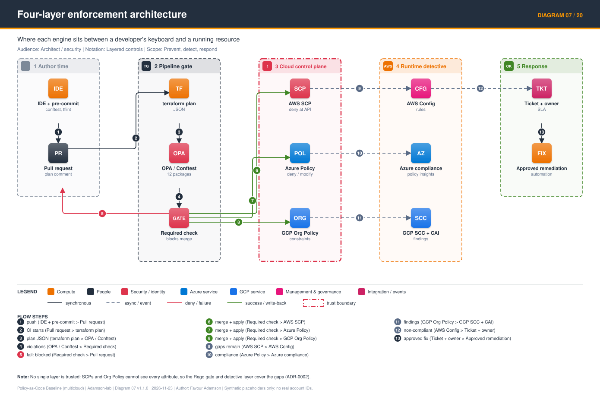

# Policy-as-Code Baseline (multicloud)
**One control catalogue generates OPA/Rego, AWS SCP, Azure Policy and GCP Org Policy, with a parity gate that proves the 1:1 mapping and states honestly where it is not equivalent.**
  

## Executive summary
Guardrails are usually written four times by four teams. This project writes each control once (`controls/definitions.py`), generates every engine's artifact, and fails the build if any control is missing from any engine or if a non-equivalent mapping lacks a documented gap. Rollout is audit-first, canary-first.

## Business context
Stakeholders: CISO, CCoE, GRC, app teams, audit. Drivers: provable consistency, audit evidence, safe rollout. Constraints: native engines differ (SCP has no audit mode and size limits; GCP custom constraints are limited). Success metrics in docs/01.

## Architecture at a glance

Four layers: author-time, CI gate (OPA), cloud control plane (SCP / Policy / Org Policy), runtime detective. All 20 diagrams: `diagrams/index.html`.

## Key design decisions
| Decision | Rejected alternatives | ADR |
|---|---|---|
| One catalogue generates all engines | hand-write each; CSPM only | [0001](docs/04-adr/ADR-0001.md) |
| Four-layer enforcement | single layer | [0002](docs/04-adr/ADR-0002.md) |
| Honest fidelity ratings | claim full equivalence | [0003](docs/04-adr/ADR-0003.md) |
| Audit-first, AWS canary OU as dry-run | direct enforce | [0005](docs/04-adr/ADR-0005.md) |
| SCP bundling for AWS limits | one SCP per control | [0006](docs/04-adr/ADR-0006.md) |
| Generated tests + oracle (supersedes 0007) | hand-written tests | [0008](docs/04-adr/ADR-0008.md) |
Index: [docs/04-adr](docs/04-adr/README.md).

## Scope
In: 12 baseline controls (storage, encryption, regions, network exposure, TLS, credentials, audit logging, tagging, databases, ingress, instance access, default networks), generators, tests, deployment modules. Out: Kubernetes admission policy, runtime remediation (see project 3), cost optimisation.

## Quick start (no cloud needed)
```bash
make all        # generate, parity-verify, test, render diagrams
make plan-ok    # oracle on a compliant sample plan -> no violations
make plan-bad   # oracle on a non-compliant plan -> 61 violations
```
Mapping matrix: [docs/mapping-matrix.md](docs/mapping-matrix.md). Cleanup: nothing is deployed.

## Repository map
`controls/` definitions, oracle, manifest - `tools/` generator, parity gate, plan evaluator - `policies/` generated Rego, SCP bundles, Azure Policy, GCP Org Policy - `infra/` Terraform modules - `diagrams/` 20 diagrams as code - `docs/` full set - `evidence/` parity report - `tests/`.

## Non-functional targets
Parity: 100% of controls in 4 engines (enforced). SCP: <= 4 bundles, <= 5120 chars (enforced). Safety: audit before enforce (process). Others are targets until sandbox evidence exists.

## Cost, security, operations, testing
[Cost note](docs/08-cost-and-finance/cost-note.md) - [Threat model](docs/06-security/threat-model.md) - [Runbooks](docs/07-operations/runbooks.md) - [Test strategy](docs/10-testing/test-strategy.md) - [Risks](docs/09-compliance-and-risk/risk-register.md).

## Trade-offs and known limitations (honest)
- **Not executed here:** generated Rego tests (no OPA binary), Terraform validate, any deployment. CI workflows are included to produce that evidence.
- Native policy JSON was written from provider documentation but not deployed; aliases and constraint names must be verified in a sandbox.
- Several mappings are partial or compensating by necessity; see the matrix.
- GCP custom constraints (CEL) need lab validation; control framework mappings need GRC review.
- Diagrams use automatic routing checked by code and geometry previews, not browser-rendered fonts.

## Roadmap, contribute, license
[ROADMAP.md](ROADMAP.md), [CONTRIBUTING.md](CONTRIBUTING.md). Maintainer: Favour Adamson, favouradamson803@gmail.com. MIT for code; CC BY 4.0 for docs and diagrams. Synthetic placeholders only.
